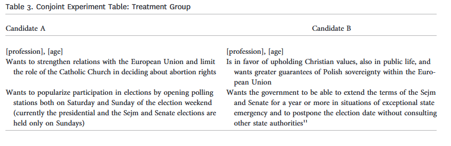
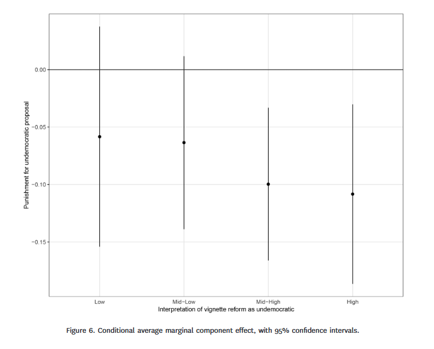
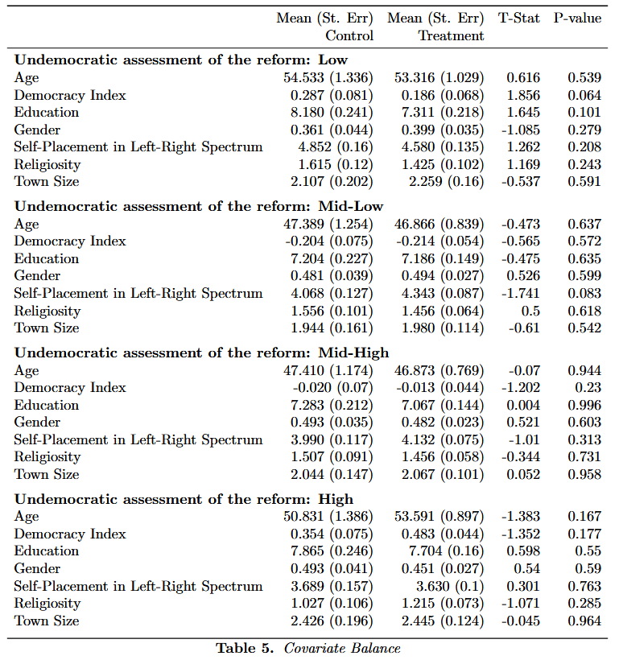
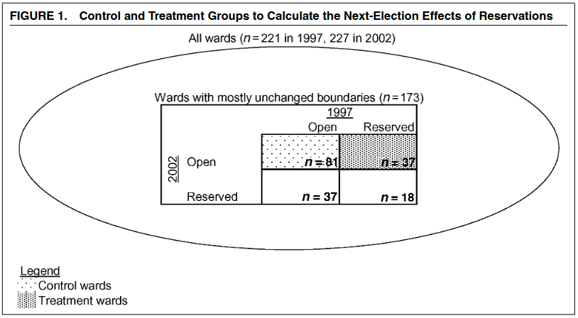
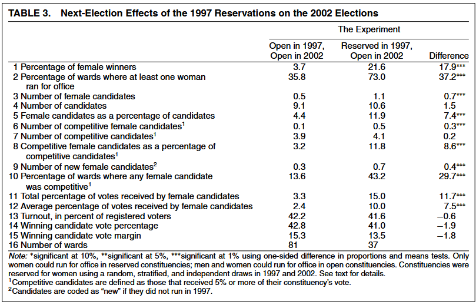

```{r setup, include=FALSE}
knitr::opts_chunk$set(echo = FALSE, warning = FALSE, message = FALSE)
library(knitr)
```

\vspace{1cm}

**About this practice exam:** This is built to the same specification as the real midterm — nine questions, 100 points plus 2 extra credit, 75 minutes, the same point distribution, and the same kinds of questions. Only the studies are different. Both studies here are ones we have discussed in class, so you should be able to focus on the *skills* the exam tests rather than on decoding unfamiliar material.

**Instructions (as they will appear on the real exam):** This exam is **open notes but closed devices**. You may consult your own handwritten or printed notes. No laptops, phones, tablets, or any electronic devices are permitted. The figures and tables you need are printed on the following pages. **Write your answers in the spaces provided below each question.** You have 75 minutes.

The exam has 9 questions worth a total of **100 points**. Point values are shown in brackets.

If you find ambiguity in a question, adopt a reasonable reading, note your assumption briefly, and proceed.

\newpage

# Figures and Tables for Study 1

\newpage
```{r chiopris-table3, out.width="95%", fig.align='center', fig.cap="**Table 3 (Chiopris, Nalepa & Vanberg)** – The paired-candidate vignette shown to the treatment group."}

```

\newpage
```{r chiopris-fig6, out.width="80%", fig.align='center', fig.cap="**Figure 6 (Chiopris, Nalepa & Vanberg)** – Conditional average marginal component effect of the undemocratic proposal on punishment, by how undemocratic respondents judged the reform to be. Bars are 95 percent confidence intervals."}

```

\newpage
```{r chiopris-table5, out.width="85%", fig.align='center', fig.cap="**Table 5 (Chiopris, Nalepa & Vanberg)** – Covariate balance between control and treatment groups, within each level of perceived undemocratic assessment."}

```

\newpage

# Figures and Tables for Study 2

*Bhavnani, "Do Electoral Quotas Work after They Are Withdrawn? Evidence from a Natural Experiment in India."*

**Background.** Seats on the Mumbai city council were **reserved for women by lottery**, one election at a time. Bhavnani compares wards that were reserved in 1997 and then open again in 2002 against wards that were open in both years, asking whether women kept winning after the quota was withdrawn.

\newpage
```{r bhavnani-design, out.width="80%", fig.align='center', fig.cap="**Figure 1 (Bhavnani)** – The research design. Treatment wards were reserved in 1997 and open in 2002; control wards were open in both years."}

```

\newpage
```{r bhavnani-table3, out.width="95%", fig.align='center', fig.cap="**Table 3 (Bhavnani)** – Next-election effects of the 1997 reservations on the 2002 elections."}

```

\newpage

# Exam Questions

## Study 1: Citizen Uncertainty and Democratic Backsliding (40 points)

*Chiopris, Nalepa & Vanberg study whether Polish voters punish candidates who propose undemocratic reforms. Respondents read a pair of candidate profiles; in the treatment condition, one candidate proposes extending parliamentary terms and postponing elections during a state of emergency.*

**Question 1** (12 points)
(a) What is the **treatment** in this study? Be specific about how it is delivered to respondents. What is the **outcome** being measured?

(b) The authors also measure how undemocratic each respondent judged the proposed reform to be, on a four-category scale from Low to High. Do you think this is a valid measure of that concept? Why or why not?

\vspace{4cm}

---

**Question 2** (10 points)
What kind of **research design** does this study use (using the categories discussed in class)? What are the main strengths and weaknesses of this design for making **causal** claims about whether voters punish undemocratic proposals?

\vspace{4cm}

---

**Question 3** (10 points)
Look at **Chiopris’s Table 5**.

- What is this table for? What does it establish?
- Name **two threats** to the study's conclusions that covariate balance does **not** address, and explain why balance cannot rule them out.
- Two of the comparisons in the table have p-values below 0.10 (Democracy Index in the Low group, and Left–Right Self-Placement in the Mid-Low group). Does this undermine the authors' claim that the groups are balanced? Explain.

\vspace{4cm}

---

**Question 4** (8 points)
Look at **Chiopris’s Figure 6**.

- For which subgroup is the estimated punishment largest in absolute magnitude? Approximately what is that estimate?
- Is the estimate for the **"Low"** subgroup statistically significant? How can you tell?
- Do all four subgroups show an effect in the same direction? What does the pattern across subgroups suggest?

\vspace{4cm}

---

## Study 2: Electoral Quotas After They Are Withdrawn (60 points)

*Seats on the Mumbai city council were reserved for women by lottery, one election at a time. Bhavnani compares wards reserved in 1997 and open again in 2002 (treatment, n = 37) against wards open in both years (control, n = 81).*

**Question 5** (10 points)  
What kind of **research design** is this (be specific)? Pay attention to **who** carried out the randomization. What are the main advantages and disadvantages of this design for descriptive and causal inference?

\vspace{4cm}

---

**Question 6** (8 points)  
What is the **treatment** in this study, and what are its two levels? What is the **unit of analysis** — what is being compared to what?

\vspace{3cm}

---

**Question 7** (12 points)  
Look at **Bhavnani’s Table 3**.

- In row 1, what percentage of control wards and what percentage of treatment wards elected a female winner in 2002? Roughly how many times larger is the treatment figure?
- Which row shows the largest difference between treatment and control? What is that difference?
- How can you tell from the table which differences are statistically significant?

\vspace{4cm}

---

**Question 8** (15 points)  
Still in **Bhavnani’s Table 3**, look at rows 4, 7, 13, 14, and 15 — number of candidates, number of competitive candidates, turnout, winning candidate vote percentage, and winning candidate vote margin.

- What do these five rows have in common, and how do they differ from rows 1, 2, and 11?
- Why would an author *want* to report rows like these, even though they show no effect?
- What would it have meant for the study's conclusions if row 13 (turnout) had shown a large and significant difference?

\vspace{5cm}

---

**Question 9** (15 points)  
Bhavnani concludes that reservations have effects that **persist after the quota is withdrawn**.

- Using Bhavnani’s Table 3, how well supported is that conclusion? Cite specific rows.
- The design compares wards reserved in 1997 against wards never reserved. What does the lottery accomplish that a simple comparison of reserved and unreserved wards could not?
- What additional evidence would you want before accepting that quotas would have similar lasting effects elsewhere?
- **Bonus (2 extra points):** Row 2 shows that 73.0 percent of treatment wards had at least one woman run, against 35.8 percent of control wards. Why might this row matter more than row 1 for understanding *why* the quota had lasting effects? (Write your answer in the space below.)

\vspace{5cm}

---

**End of practice exam.**
*Total points: 100 (plus up to 2 extra credit).*

\vspace{0.5cm}
**Note:** On the real exam you will write your answers on the exam paper and hand it in before leaving.
